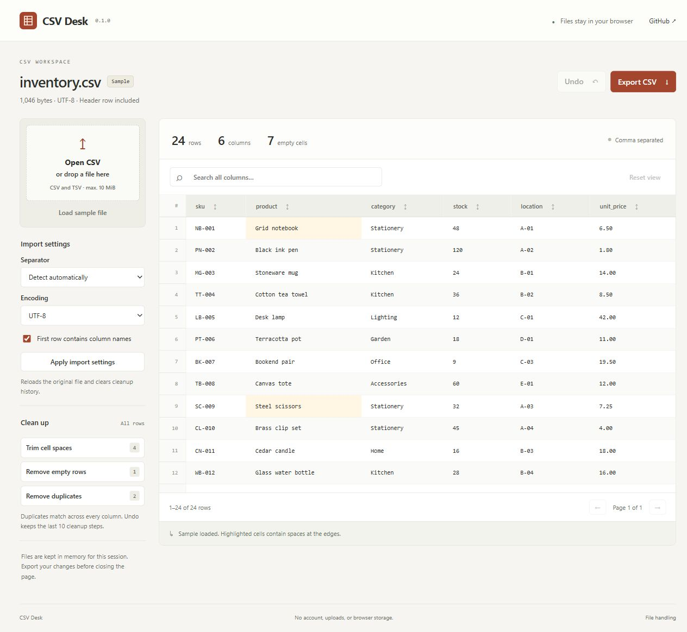

# CSV Desk

[](https://github.com/Almeida96/csvdesk/actions/workflows/ci.yml)

Open a CSV, check its contents, and download a cleaned copy. Files are processed in the browser and kept in memory until you close or reload the page.

[Open CSV Desk](https://almeida96.github.io/csvdesk/)



## Usage

Open a CSV or TSV file, or use the included inventory sample. Choose the separator and encoding before opening a file if automatic detection does not fit your data. **Apply import settings** reloads the original file and clears cleanup history.

- Search across all columns. Click a column heading to sort; click it again to reverse the order.
- Trim spaces at the edges of data cells, remove empty rows, or match duplicates by selected columns. Cleanup applies to the entire file, including rows hidden by search.
- Undo up to 10 cleanup steps. Search and sorting only change the view.
- Export all rows in their original order, or matching rows in the current sort order. Choose which columns to include and whether to write a header.

Duplicate removal keeps the first matching row and compares every column, including case and spaces. Trim first if you want `" item "` and `"item"` to count as the same value. Trimming leaves column names unchanged.

## Match duplicates by key

Use **Remove duplicates** to choose the columns that identify a record, such as an email, a SKU, or an account-and-date pair. The preview shows how many rows will be removed before applying the change. Keep either the first or last occurrence in the original file; sorting the table does not change that choice.

Case folding and trimming are optional comparison rules. They do not rewrite retained values. Rows with any empty key field are kept by default, so incomplete records are not silently collapsed. Uncheck that option to treat empty fields as ordinary values. Matching is exact after the selected normalization; it is not fuzzy matching.

For example, select `email` and keep the last occurrence to retain an updated contact even if its name or phone differs. Undo restores the complete previous table. The sidebar badge counts full-row duplicates; the dialog calculates matches for the selected keys.

## File handling

| Setting | Supported values |
| --- | --- |
| Separator | Comma, semicolon, tab, or pipe; automatic detection is available |
| Input encoding | UTF-8, with or without a BOM; Windows-1252 when selected |
| Input line endings | CRLF, LF, or CR |
| Quoting | Double quotes, escaped double quotes, and line breaks inside quoted fields |
| Limits | 10 MiB per file, 50,000 data rows, 100 columns, 500,000 cells |
| Export | UTF-8, CRLF line endings, optional BOM |

Values remain strings. Import does not convert dates or numbers, strip spaces, or remove leading zeros. Sorting uses English natural text order, not numeric or date types. Empty cells appear as a dash in the table; exported cells remain empty.

Short rows are padded with empty cells and reported above the table. Extra fields are retained, even when the header has fewer columns. Blank or repeated header names stay unchanged in the export. For a file without a header, the table shows generated names such as `Column 1`; these are omitted from export by default.

Separator detection checks up to 30 nonempty records and prefers a consistent field count. Check the preview when a file has mixed separators or an unusual layout. Malformed quotes produce an error with a line number. UTF-16 files must be saved as UTF-8 first. XLSX files are not supported.

### Spreadsheet formulas

Export prefixes formula-like cells with an apostrophe by default. This includes cells beginning with `=`, `+`, `-`, or `@`, their full-width variants, and leading tabs or line breaks. It also affects negative numbers. Turn the option off to preserve those values exactly.

This changes the exported data, including affected headers. It does not change the table in memory. Spreadsheet applications differ in how they handle prefixes, especially after saving and reopening files; this option is not a guarantee against formula execution. See [OWASP's CSV injection guidance](https://owasp.org/www-community/attacks/CSV_Injection).

### Storage and network

CSV Desk has no backend, analytics, cookies, or local storage. Opening a file reads it through the File API. Parsing runs in a Web Worker. The app requests its own static assets and sample file; imported file contents are not sent over the network. Refreshing the page loads the sample again.

The hosted version is served by GitHub Pages. You can also run it locally.

## Run locally

Requires Node.js 22 or later. There are no dependencies to install.

```sh
git clone https://github.com/Almeida96/csvdesk.git
cd csvdesk
npm run build
npm run dev
```

Open `http://127.0.0.1:4174`. Rebuild and reload after editing files. Opening `index.html` directly through `file://` will not work because the app uses modules and a worker.

The same commands work without npm: `node scripts/build.mjs` and `node scripts/serve.mjs`.

## Development

```sh
npm run check
npm test
npm run build
```

`src/csv.js` handles parsing, separator detection, decoding, and serialization. `src/table.js` handles cleanup, search, sorting, and export selection. Both modules can be imported directly in Node.js. `src/import-worker.js` runs imports off the UI thread; `src/app.js` connects the controls and table.

Tests cover quoted fields, encoding failures, limits, uneven rows, cleanup order, filtering, sorting, and export selection. A seeded test runs 500 CSV round trips across the supported separators. Browser checks should cover file selection, downloads, keyboard navigation, and narrow layouts.

GitHub Actions runs checks on Linux, Windows, and macOS. After they pass on `main`, the Pages job publishes `dist/`. The parser's quoting rules follow [RFC 4180](https://www.rfc-editor.org/rfc/rfc4180); the other separators and line endings are additional supported inputs.

[Contributing](CONTRIBUTING.md) · [Changelog](CHANGELOG.md) · [MIT license](LICENSE).
